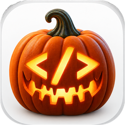

<p align="center">
  <picture>
    <source media="(prefers-color-scheme: dark)" srcset="docs/code-o-ween.png">
    
  </picture>
</p>

# Code-o-ween 🎃

Disguise VS Code and other Mac apps for trick or treat.

Under the costume, each disguise is a genuinely separate copy of the app with its own Dock
icon, ⌘-Tab entry, settings, sessions, and logins. Dress up Visual Studio Code, a browser,
Slack, or almost any other app, in a Halloween costume, any emoji, or your own image.

Website: [flaky-test-monster.github.io/code-o-ween](https://flaky-test-monster.github.io/code-o-ween/)

## Do you need this?

VS Code's built-in **Profiles** (File → New Profile) already give you separate settings,
extensions and UI state, switchable inside one app. Use them if that is all you need.

Code-o-ween is for what Profiles cannot do: disguises are **separate apps to macOS**. Each has
its own Dock icon and ⌘-Tab identity, its own GitHub and Microsoft logins, and can sit in the
Dock next to the others. The price is that each disguise is a full copy of the app that has to
be rebuilt (`code-o-ween refresh --all`) after the original updates, and that macOS asks once
per disguise before it may use its Keychain item.

## Love the idea, but afraid (very afraid) to run it?

Fair. You don't have to run a 2,000-line script that re-signs apps. Everything it does for
VS Code can be done by hand, and doing it yourself is a good way to see there is no magic in it.
There are two levels.

### Level 1: no copy, no signing, nothing to undo

Separate settings, extensions and logins only need two flags. Your real VS Code is not touched:

```bash
code --user-data-dir ~/.vscode-side-a --extensions-dir ~/.vscode-side-a/extensions
```

Make it a shortcut in `~/.zshrc`:

```bash
alias code-side-a='code --user-data-dir ~/.vscode-side-a --extensions-dir ~/.vscode-side-a/extensions'
```

What you don't get: a Dock icon and ⌘-Tab entry of its own. To macOS it is still the one
"Code" app, so it shares the Dock icon with your normal windows. To undo, delete
`~/.vscode-side-a`.

### Level 2: the full costume, by hand

This is what `code-o-ween create` does, step by step, in a simplified form. Quit VS Code first.

```bash
APP=~/Applications/"VS Code - Side A.app"
DATA=~/.vscode-side-a
cp -cR "/Applications/Visual Studio Code.app" "$APP"   # an APFS clone, nearly free on disk
EXE="$(/usr/libexec/PlistBuddy -c 'Print :CFBundleExecutable' "$APP/Contents/Info.plist")"
```

1. **A launcher** becomes the app's executable and starts the original one with its own
   settings folder. The original executable keeps its name, because Electron finds its helper
   apps from it.

   ```bash
   cat >"$APP/Contents/MacOS/side-a-launcher" <<EOF
   #!/bin/bash
   here="\$(cd "\$(dirname "\$0")" && pwd)"
   if [[ "\${ELECTRON_RUN_AS_NODE:-}" == "1" ]]; then exec "\$here/$EXE" "\$@"; fi
   mkdir -p "$DATA/user-data"
   exec "\$here/$EXE" --user-data-dir "$DATA/user-data" "\$@"
   EOF
   chmod +x "$APP/Contents/MacOS/side-a-launcher"
   ```

2. **A new identity** in `Info.plist`, so macOS treats it as a different app. Leave
   `CFBundleName` alone: Electron needs it to find `Code Helper.app`, and the app quits at launch
   without it.

   ```bash
   plutil -replace CFBundleExecutable -string side-a-launcher "$APP/Contents/Info.plist"
   plutil -replace CFBundleIdentifier -string local.my-disguise.side-a "$APP/Contents/Info.plist"
   plutil -replace CFBundleDisplayName -string "VS Code - Side A" "$APP/Contents/Info.plist"
   ```

3. **A costume (optional).** Add your own `.icns`, point the app at it, and remove the asset
   catalog entry that would otherwise win:

   ```bash
   cp ~/Pictures/ghost.icns "$APP/Contents/Resources/costume.icns"
   plutil -replace CFBundleIconFile -string costume.icns "$APP/Contents/Info.plist"
   plutil -remove CFBundleIconName "$APP/Contents/Info.plist"
   ```

4. **A Keychain item of its own.** Open `$APP/Contents/Resources/app/package.json` in a text
   editor and change `"name": "Code"` to `"name": "Code Side A"`. The copy then keeps its login
   secrets in a `Code Side A Safe Storage` item instead of asking for VS Code's own, which only
   trusts Microsoft's signature.

5. **Re-sign the copy ad hoc.** The edits above broke Microsoft's signature, and macOS refuses
   to open an app whose signature does not verify:

   ```bash
   codesign --force --deep --sign - "$APP"
   codesign --verify --deep --strict "$APP" && echo "signature OK"
   ```

   This simple form drops the hardened runtime, so other programs could inject code into the
   copy with `DYLD_*` variables. `code-o-ween` signs inside-out and keeps the hardened runtime
   instead; see `sign_disguise` in [`code-o-ween`](code-o-ween) for the exact commands.

6. **Stop it from updating itself.** Open the app once, then add `"update.mode": "none"` to
   `~/.vscode-side-a/user-data/User/settings.json`. A self-updating copy would undo all of the
   above. When the real VS Code updates, delete the copy and repeat steps 1–5; the settings
   folder, and with it your settings and logins, stays.

Open it from `~/Applications`, choose **Always Allow** when macOS asks about the Keychain, and
drag it to the Dock. To undo everything:

```bash
rm -rf "$APP" ~/.vscode-side-a
security delete-generic-password -s "Code Side A Safe Storage"
```

These manual steps are a transcription of the script for reading, not a tested recipe: the
script's own path is the one verified on a Mac. If a
step fails for you, the script's source next to it shows how it handles that case, and an issue
is welcome.

## Install

Clone or download the repository, then run the installer from its folder:

```bash
./install.sh
```

This installs the `code-o-ween` command into `~/.local/bin` and, when Apple Command Line
Tools are available, builds the manager app:

```text
~/Applications/Code-o-ween.app
```

Open it from Finder, Spotlight, or with:

```bash
code-o-ween gui
```

The disk image on the [Releases](https://github.com/flaky-test-monster/code-o-ween/releases) page holds
the app alone, with the command bundled inside it. It is signed ad hoc, so macOS asks you to
open it once with right-click → Open. Building the app requires macOS 13 or newer; the command
works without it.

## What can be disguised

| App | `--app` | Status | How the disguise keeps its data apart |
| --- | --- | --- | --- |
| Visual Studio Code | `vscode` (default) | **verified** | `--user-data-dir`, optionally `--extensions-dir`, a Keychain item of its own, a terminal shortcut on the app's own CLI (`code-NAME`), and `update.mode` pinned to `none` so the copy never updates itself |
| VS Code Insiders, VSCodium | `vscode-insiders`, `vscodium` | not yet verified | the same mechanism as VS Code; not yet run as disguises on a Mac |
| Google Chrome, Chromium, Microsoft Edge, Brave | `chrome`, `chromium`, `edge`, `brave` | **not working** | `--user-data-dir=`; `create` refuses them, see below |
| Firefox | `firefox` | not yet verified | `--profile` |
| Slack, Discord, Obsidian | `slack`, `discord`, `obsidian` | not yet verified | a private `HOME`, so `~/Library` (settings, caches, preferences) is separate; Desktop, Documents, Downloads, Movies, Music, and Pictures are linked to the real folders |
| Anything else | `--source /path/to/App.app` | not yet verified | a private `HOME`, as above |

Every disguise is built the same way: the app bundle is cloned, a small launcher becomes its
executable, and the copy gets its own bundle identifier, display name, icon, and ad-hoc
signature. The original installation is never modified.

`code-o-ween apps` lists the recipes with their status and where each app was found. With
`--source` alone, the app is recognized from its bundle identifier; a VS Code-style app that is
not in the list (a fork with its own name) gets the VS Code treatment, and anything else gets a
private `HOME`.

What the statuses mean:

- **Verified**: the VS Code mechanism has been run end to end on macOS, including a real
  launch.
- **Not yet verified**: the launcher and shortcut are generated and covered by
  `tests/safety.sh`, but the app has not been launched as a disguise on a Mac. Creating one
  prints a warning. Treat it as a first cut and report what you see.
- **Not working**: Chromium-based browsers ship their framework several versions behind a
  `Versions/Current` symlink, which cannot be re-signed by the means used here. The copy would
  fail signature verification and macOS would refuse to open it, so `create` refuses the recipe
  up front and leaves nothing behind.

Only apps with a valid code signature are copied, and Visual Studio Code and Google Chrome
must come from their publisher. For another build (for example VSCodium), pass
`--source APP --trust-source`, or turn on **Trust this app's signature** in the manager, which
is offered for "Other app…" and for recipes that are not yet verified.

Keychain: only VS Code-style disguises get a Keychain item of their own. A disguised browser or
Electron app keeps using the original app's `… Safe Storage` item, so macOS asks once per app
version whether the copy may use it. Choose **Always Allow**; denying leaves the disguise unable
to save logins.

Sandboxed apps (App Store builds) keep their data in `~/Library/Containers/<bundle identifier>`,
so the new identifier alone separates it. Re-signing drops the entitlements such apps may rely
on, so prefer direct downloads.

## Pick a costume

The manager includes quick Halloween disguises:

- 🎃 Pumpkin
- 👻 Ghost
- 🧛 Vampire
- 🧙 Witch
- 🕷️ Spider
- 💀 Skeleton

You can then change the emoji, pick one of 15 preset colors or any color with the color picker,
or select a custom image. The manager's App picker lists code editors (the VS Code-style
recipes) plus "Other app…"; browsers and chat apps are created from the command line.

## Command-line examples

```bash
code-o-ween create Cauldron --color orange --emoji "🎃" --extensions isolated
code-o-ween create Personal --app chrome --color purple --emoji "👻"
code-o-ween create Standup --app slack --color teal
code-o-ween create Work --icon ~/Pictures/vampire-code.svg
code-o-ween create Beta --source "/Applications/Some Other App.app"
code-o-ween create Night --color "#1A1A2E" --emoji "🦇"
code-o-ween create Cauldron --emoji "🎃" --folder ~/code/cauldron
```

New VS Code-style disguises also tint the window (title bar, activity bar, and status bar) with
their color, and show the emoji at the start of the window title. Turn the tint off with
`--window-color off` or the **Tint the VS Code window** switch.

`--folder` pins a project folder: opening the disguise from Finder, the Dock, or
`code-o-ween open NAME` opens that folder. In the manager, use **Project folder → Choose…**.
Both options apply to VS Code-style apps only, and are refused for others rather than ignored.

Closing the last window does not quit a disguise on macOS. Clicking its Dock icon then shows an
empty window, as VS Code does; **Open** in the manager and `code-o-ween open NAME` hand the
pinned folder to the running copy instead. Quit the disguise (⌘Q) to have the Dock open the
folder again.

`--extensions shared` uses your normal extensions. `--extensions isolated` gives the disguise a
separate extension directory. Both apply to VS Code-style apps only.

SVG, PNG, JPEG, TIFF, WebP, and ready-made ICNS files are supported as icons. A square source
is recommended; other formats are converted into the multi-resolution `.icns` format macOS
requires.

`--color` takes a preset name or any `#RRGGBB` color. The presets, darkest first, are `black`,
`navy`, `magenta`, `indigo`, `brown`, `slate`, `purple`, `lime`, `yellow`, `orange`, `green`,
`teal`, `red`, `blue`, and `pink` (`code-o-ween colors` lists them with their values). Every
preset is dark enough for white text on the window tint (a contrast of at least 4.5:1). `blue`,
`green`, `orange`, `pink`, `purple`, `red`, `teal`, and `yellow` have hand-made icons for
VS Code-style apps; other colors get a drawn `</>` badge, and other apps wear their own icon on
the colored tile.

Names must be unique across apps: "Work" cannot be both a Chrome and a VS Code disguise. They
cannot start with `-` or contain control characters.

## Change a disguise

In the manager, click **Edit…** on a disguise's row (or right-click it) to change its color,
icon, or pinned folder. From the command line:

```bash
code-o-ween update Cauldron --color purple          # recolors emoji and built-in icons
code-o-ween update Cauldron --emoji "👻"
code-o-ween update Cauldron --built-in-icon
code-o-ween update Cauldron --folder ~/code/cauldron  # or --no-folder
code-o-ween update Cauldron --window-color off      # or on
```

Color and icon changes rebuild the app, so quit that disguise first; settings, logins, and
extensions are kept. A pinned-folder change is saved right away and is used the next time the
disguise is opened. Window-tint changes show up in the running window.

The tint is written to `workbench.colorCustomizations` in the disguise's own `settings.json`,
changing only the title bar, activity bar, and status bar keys inside it; your own colors and
comments there stay. The emoji goes into `window.title` as a prefix of VS Code's default title;
the exact title written is recorded, and only that value is ever replaced or removed, so a
title you customized yourself is left alone. If the file cannot be edited (invalid JSON, a
broken symlink), `create` and `refresh` stop and leave the previous disguise in place, because
a disguise is never installed without `update.mode` pinned.

## Open a disguise

```bash
code-o-ween open Cauldron -- ~/code/cauldron
code-cauldron ~/code/cauldron
chrome-personal https://example.com
```

Terminal shortcuts are named after the app: VS Code-style disguises get `code-NAME` (or
`codium-NAME`, …), other apps get `chrome-NAME`, `slack-NAME`, and so on. They open the
disguise and hand it any arguments, for example a path or a URL.

Disguises live in:

```text
~/Applications/Code-o-ween/
```

Drag your favorites to the Dock.

## Refresh the disguises

After the original app updates, rebuild the costumes while preserving their settings,
extensions, and icons:

```bash
code-o-ween refresh --all
```

Quit the affected disguises first. `refresh --all` continues past a disguise that fails and
lists the failures at the end. macOS then asks once per disguise before it can use its Keychain
item again; choose **Always Allow**.

To rebuild one disguise from a different copy of its app (for example a VSCodium build you
moved), pass `refresh NAME --source APP`; if that build is not signed by an identified
developer, add `--trust-source` to grant trust for the new source explicitly. Trust recorded
earlier applies only to the source it was given for.

## Remove a disguise

```bash
code-o-ween remove Experiments
```

Settings are kept by default. To remove them too (this also deletes the disguise's Keychain
item, if it has one):

```bash
code-o-ween remove Experiments --delete-data
```

## Other commands

```bash
code-o-ween list      # includes pinned folders
code-o-ween apps
code-o-ween colors
code-o-ween doctor
code-o-ween --version
```

## Notes

- macOS may briefly verify a newly created disguise the first time it opens.
- Rebuilding modifies only the copied bundle and signs it ad hoc, keeping the app's hardened
  runtime. Library validation is turned off for the copy's executables, because once re-signed
  they no longer share the publisher's Team ID with the frameworks they load. The original
  installation is untouched.
- Logins are per disguise: signing in inside your main app does not sign in a disguise, and
  vice versa.
- Settings live under `~/.code-o-ween/` (or `CODE_O_WEEN_DATA_ROOT`; keep it short, VS Code's
  IPC socket lives there). Settings folders carry a `.code-o-ween-profile` marker, and
  Code-o-ween refuses to use or delete a folder it did not create, a folder that is a symbolic
  link, and your home folder.
- A disguise with a private `HOME` sees the linked folders (Desktop, Documents, …) but not
  dotfiles such as `~/.ssh` or `~/.gitconfig`. This is why VS Code-style apps use
  `--user-data-dir` instead.
- APFS clones are used where possible, so disguises initially consume little additional disk
  space.
- Commands take a per-disguise lock while they rebuild or remove it. A stale `.lock-NAME`
  folder left by a crashed run can be removed by hand.
- Other locations can be overridden with `CODE_O_WEEN_APP_ROOT` (disguise apps) and
  `CODE_O_WEEN_BIN_ROOT` (terminal shortcuts); `code-o-ween --help` lists them all.

## Tests

```bash
tests/safety.sh        # fast checks of guards and generated scripts, no side effects
tests/window-color.sh  # settings.json editing for the window tint and emoji title (needs VS Code)
tests/rebuild.sh       # create/update/refresh/remove in temp folders without launching (~1 min)
tests/ui-check.sh      # manager UI logic against the real CLI, plus screenshots (needs Swift)
tests/launch-macos.sh  # launches a disguise briefly from temp folders, then removes it
```

Conventions and invariants for contributors are in [`AGENTS.md`](AGENTS.md).

## Build a disk image

```bash
./build-dmg.sh                                      # dist/Code-o-ween-0.1.0.dmg, current architecture
CODE_O_WEEN_BUILD_ARCHS="arm64 x86_64" ./build-dmg.sh   # one app for Apple Silicon and Intel
```

The app is built into a staging folder, so `~/Applications/Code-o-ween.app` is left alone. The
image holds the app and an Applications shortcut, and a `.sha256` file is written next to it.
Set `CODE_O_WEEN_CODESIGN_IDENTITY` to a Developer ID name to sign the app and the image with
it; otherwise both stay ad-hoc signed and macOS asks once to open the app with right-click →
Open. Notarization is left to the release manager (`xcrun notarytool`, see the script).

The same steps run in GitHub Actions (`.github/workflows/release.yml`): on every `v*` tag the
image is built on a macOS runner, checked against the `VERSION` in `code-o-ween`, and attached
to the GitHub release; a manual run only uploads it as a workflow artifact. A release image is
never replaced once attached, and it carries a build provenance attestation, so a download can
be checked against this repository's workflow:

```bash
gh attestation verify Code-o-ween-0.1.0.dmg --repo flaky-test-monster/code-o-ween
```

The `.sha256` file only detects a damaged download; it is hosted next to the image and proves
nothing about where the image came from.

## Contributing

Issues and pull requests are welcome, especially reports from running the not-yet-verified
recipes (Firefox, Slack, Discord, Obsidian, your own `--source`). Run `tests/safety.sh` and
`shellcheck -x code-o-ween build-ui.sh build-dmg.sh install.sh tests/*.sh` before opening a
pull request, and say which of the macOS tests you ran. Release notes are in
[`CHANGELOG.md`](CHANGELOG.md).

To publish a fork under another account or name, run `./set-repository.sh OWNER/NAME`: it
rewrites every GitHub address in this README and on the website. The workflows need no change.

## License

[MIT](LICENSE). Visual Studio Code is a trademark of Microsoft Corporation and macOS is a
trademark of Apple Inc.; Code-o-ween is not made or endorsed by either.
